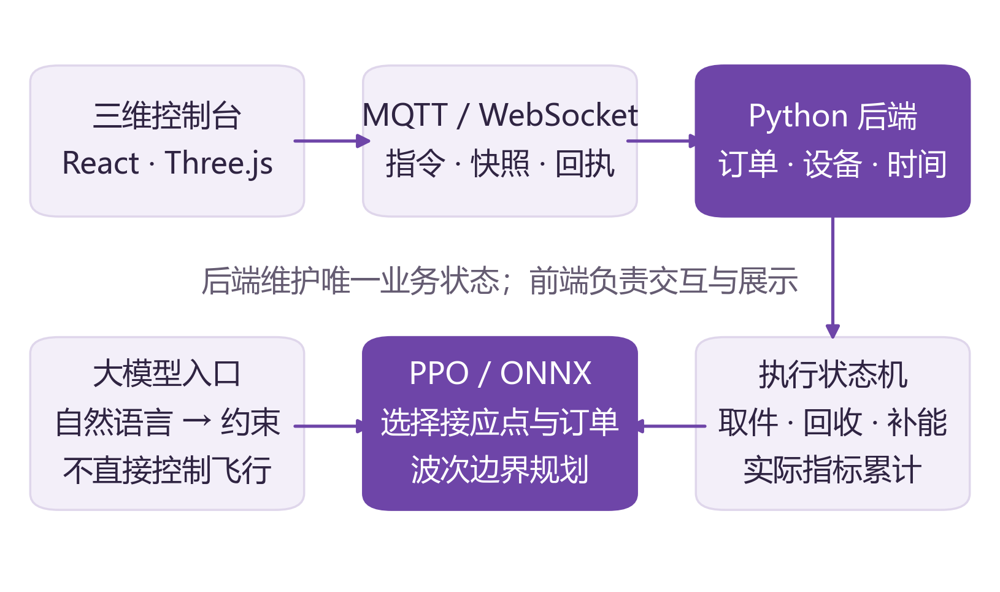

# NEXUS 园区空地协同取件系统

V2 / frontend-showcase-20261014V2 / f3b5bc9 / 2026-10-23

## 从园区取件的协同难题出发

> 作品定位：用一辆移动母车与三架无人机，把“谁去取、去哪里汇合、怎样完成回收”连接成一个可观察、可干预、可验证的仿真闭环。

### 背景：订单分散，取件过程却相互牵连

园区建筑分布分散，取件点既可能在中庭，也可能位于楼层阳台。用无人机跨越水平和高度距离，具有值得研究的灵活性；但引入无人机后，问题并不会自动消失。设备需要起降和补能，货物需要回收到母车，多架无人机还会争用卸货口。单独缩短某架飞机的航程，未必能缩短全部订单的等待。

例如，母车停在原地时，远端订单可能需要较长返程；母车提前移动到一个接应点，则可能缩短返程，但过远的车程又会让无人机悬停等待。这种相互影响，正是协同调度值得研究的原因。上述场景是本作品的设计动机，不是来自某个企业的已测量运营损失。

### 痛点一：只看单机局部最短，容易忽略集体等待

最近订单、订单中心等规则容易实现，也适合作为基线。但它们对母车位置、设备电量、回收队列之间的耦合表达有限。本作品将接应点与选单合并进一个共享决策过程，尝试让策略从整轮时延与能耗中学习折中。

### 痛点二：算法分数与现场过程脱节

只展示训练奖励，难以解释设备为何等待、订单何时算完成。NEXUS 把订单状态、波次分配、飞行与回收过程、候选评分和实时指标放入同一控制台，让策略结果能够沿着具体动作追溯。

### 痛点三：复杂指令不便表达，执行边界容易模糊

操作者可能希望指定区域、设备或预算。本作品提供预设和自然语言两种入口，并明确区分指令解析、后端确认与当前波次执行。运行中的新约束通常在回收后应用，暂停和急停则立即生效。

## 解决方案：决策、执行与展示分层

图 1  系统职责分层：大模型理解约束，PPO 规划，后端执行，前端展示。

### 一个共享策略，协同决定取件与接应

每个波次，PPO 读取当前待取订单集合及设备状态，先从 9 个道路候选点选择母车接应位置，再依次为三架无人机选单。已分配的订单被掩码排除。必要补能后共同出发，母车同时移动；所有设备回收归位后重新规划。集中式设计便于处理小规模车机协同，也限制了当前对异步任务的支持。

### 一个可信执行源，让画面对应真实仿真状态

Python 后端维护订单、设备、电量和时间，使用状态机执行起飞、进近、取件、返航、单舱排队卸货与归位。React / Three.js 前端经 MQTT 接收快照并平滑展示；浏览器动画不会直接判定订单完成。这为后续替换调度算法、复验流程和定位故障提供了清晰接口。

### 动态订单与语言约束接入同一业务闭环

演示开局随机 4–8 单，每 12 个仿真秒尝试补入一单，每轮最多 30 单。8 个物理点位占用时会重试；新单进入后续波次。大模型只把人话解析成区域、设备和预算等字段，后端校验后交给 PPO。真实 DeepSeek 调用已验证；没有大模型时，开始任务和预设仍可用。

> 当前完成口径是“包裹在母车卸货完成”。作品聚焦园区取件回收，不把这一步延伸表述为最后一公里全链路配送已经完成。

## 可行性：用证据说明已做到哪里

### 算法可行性：有强基线、有独立测试、有收益边界

最终模型从随机参数训练，两组种子分别经历 23,040 个任务；用 64 个验证场景选模，再在 512 个未用于最终选模的静态场景测试。相对“时间/能耗规则选单 + 订单中心母车”基线，平均完成时延由 91.057 秒降至 89.494 秒，每单无人机能耗由 8.193 Wh 降至 8.006 Wh。

| 静态离线指标 | 相对强规则基线改善 |
| --- | --- |
| 平均订单完成时延 | 1.72% |
| 每完成一单的无人机能耗 | 2.29% |
| 时延 + 6 × 每单能耗 | 1.92% |

配对 bootstrap 95% 差值区间支持上述相对基线的改善。收益幅度有限，但在相同环境下同时考察时延与能耗，比只展示一条下降奖励曲线更有解释力。消融显示主要收益来自母车接应策略，学习选单的额外贡献尚未证实；这一结论为后续改进指明了方向。

### 工程可行性：训练权重已进入真实运行路径

模型通过 ONNX 在本机 CPU 推理，日常展示无需训练框架或专用 GPU。ONNX 与 PyTorch 导出校验中，32 次决策逐项一致，有效分数最大误差约 9.54×10⁻⁶。服务启动、遥测、回执与控制逻辑均有对应实现，不是预设航线的视频播放。

当前回归包含 31 项后端测试、13 项前端测试和生产构建；真实 WebSocket 整轮测试覆盖动态 30 单回收、补单、暂停、急停、继续、重复控制和旧轮次拒绝。自然语言指派 B 区 1/3 号机、下一波预算更新与急停也通过真实接口验收。测试通过说明既定仿真流程可运行，不等于实机安全认证。

### 部署与推广的前提

现阶段更适合作为教学展示、调度研究和方案沟通原型。进一步接入硬件前，需要实机能耗与时间标定、避障与禁飞约束、通信故障处理、硬件在环验证以及适用场景的运行许可。当前没有量化实地降本、碳减排或替代人工的证据。

## 价值评估与下一步

### 已经能够交付的价值

| 方向 | 当前价值与评估方式 |
| --- | --- |
| 教学与展示 | 把选单、接应、电量与排队变成可观察过程，适合讲解多设备协同和强化学习。可通过演示完整性与解释准确性评估。 |
| 算法研究 | 训练、基线、消融、导出和在线适配形成闭环，便于继续对比规则与学习策略。价值在可复验，不在宣称全面领先。 |
| 方案沟通 | 让需求方用区域、设备和预算讨论调度约束，能直观看到波次切换与执行反馈。适合原型沟通，不替代现场测试。 |
| 工程验证 | 单一后端状态源、任务轮次与指令版本保护降低演示中旧结果误执行的风险，便于排查状态不同步。 |

### 为什么这个故事能够自洽

作品从“远端订单返程长、回收需要同步”的协同问题出发，选择让母车也参与决策；从“结果不可见”的问题出发，把同一任务的策略、动作和指标展示出来；从“人机交互不便”的问题出发，用结构化约束连接自然语言与调度。每个功能都服务于同一条取件回收主线。

系统最有说服力的部分是：确有策略在选接应点与订单，确有后端在执行回收约束，且有离线评估与动态运行记录可以相互核对。作品贡献在这些部分的系统化连接，不主张提出了全新的 PPO 算法或首次解决车机协同问题。

### 下一步按证据推进

第一步，针对动态订单重新训练，加入订单年龄、到达强度等特征，并与相同动态业务下的强规则比较。第二步，探索异步派单与连续接应，衡量同步波次等待的代价。第三步，在多种子、更大场景和不同能耗权重下测试稳健性。第四步，基于实测参数和硬件在环逐步缩小仿真到现实的差距。

> 对外表述建议：NEXUS 是一个已经跑通动态取件流程、能够展示学习策略与人工约束如何协作的原型。它提供了继续研究车机协同的实验基础，而不是已经完成商业部署的无人配送产品。

### 依据与版本

本说明基于 f3b5bc9。算法数字来自 experiments/dispatch_v2/results/summary.json；动态整轮和 AI 验收来自 frontend/output/v2-integration/ 下的两份 acceptance.json；模型与运行边界见 frontend/docs/v2-integration.md。相关工作与算法文献列于配套双栏技术文档。