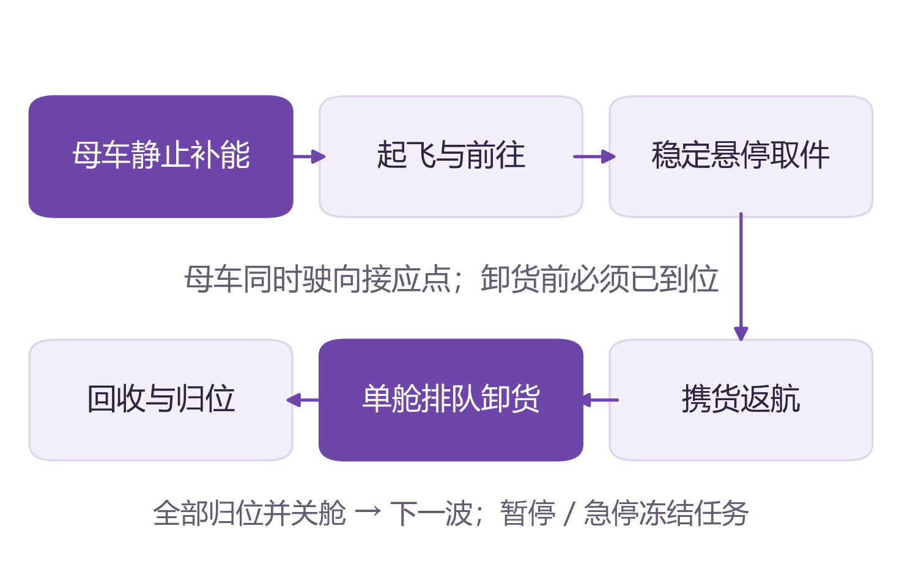
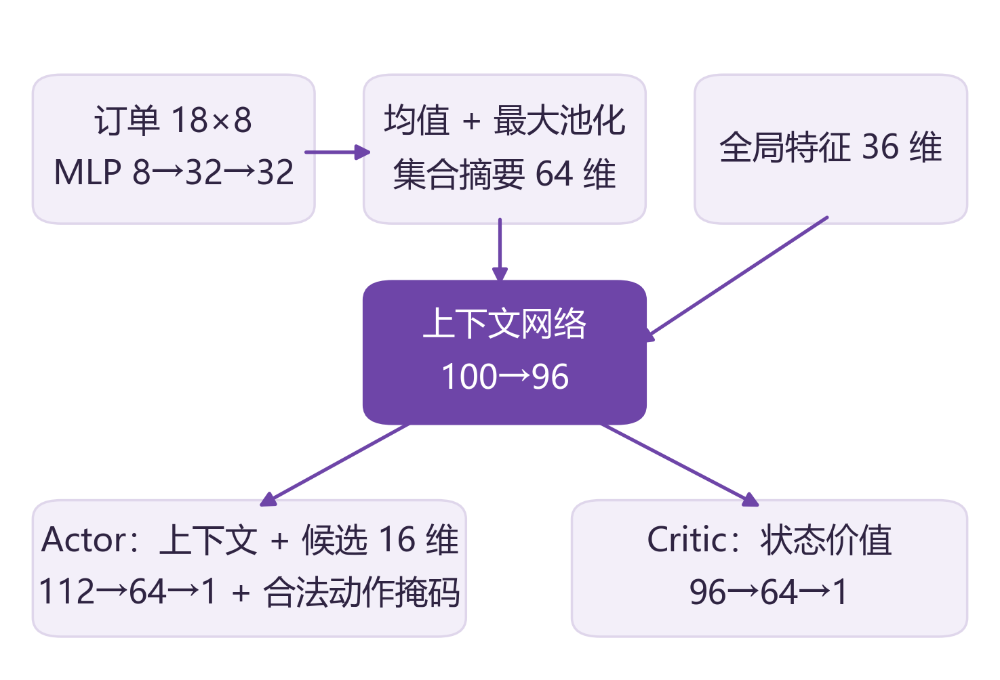
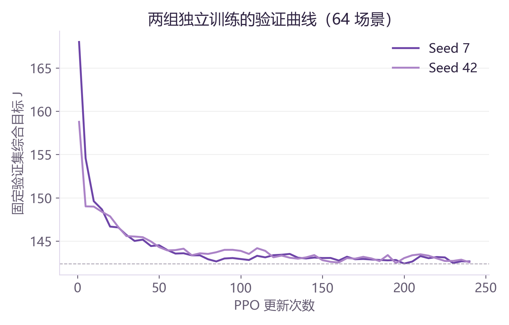
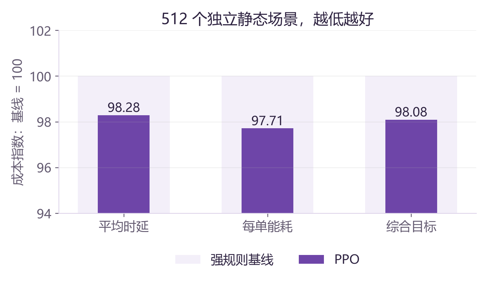
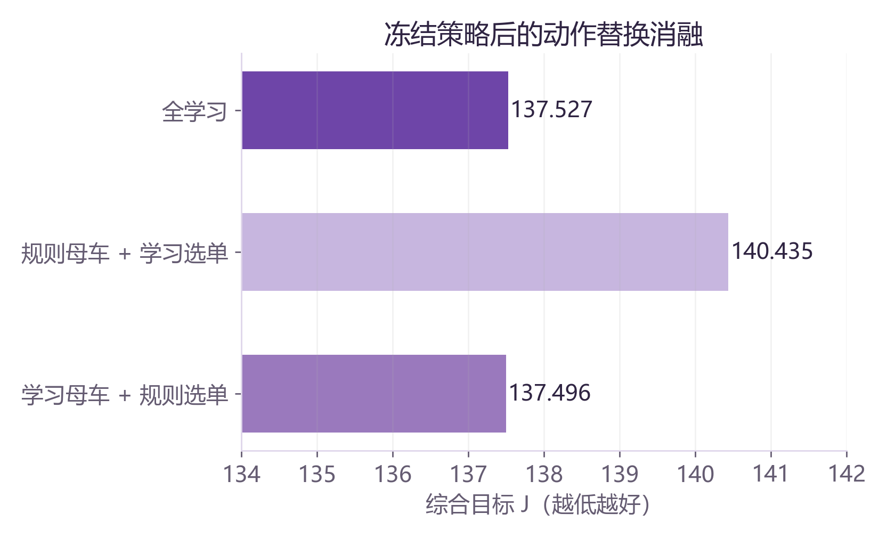
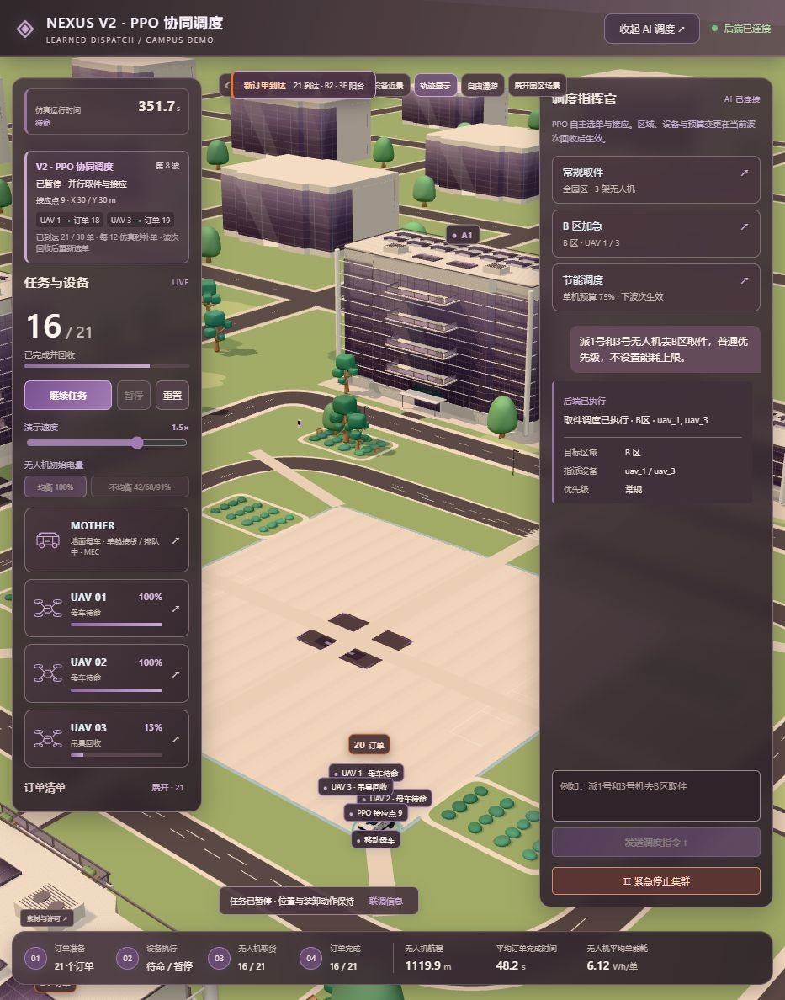

# NEXUS 园区空地协同取件系统：建模、算法与评估

V2 / frontend-showcase-20261014V2 / f3b5bc9 / 2026-10-23

## 1 介绍

### 1.1 场景背景与问题边界

园区取件同时涉及分散的空间位置、楼层高度、设备电量和回收资源。移动母车可作为起降、补能与货物汇集节点，三架无人机负责从建筑或中庭取回包裹。母车位置会影响返航距离，母车行程又可能引起无人机等待，多个到达还会争用单舱卸货口。因此，局部最短航程不必然对应整轮最小时延。

本作品研究这一小规模协同取件过程，并将其实现为可交互三维仿真。当前订单完成时刻定义为包裹在母车卸货完成；母车后续干线运输与最终收件不在任务范围。系统未连接实机，文中秒数和 Wh 均受仿真假设约束。

### 1.2 相关工作

Murray 与 Chu 的 flying sidekick traveling salesman problem 研究卡车与无人机联合服务客户的路径和协同问题 [1]，说明车机路线与汇合存在耦合。本作品借鉴其协同思想，但业务是多机取件回收，采用离散接应点及同步波次，并不声称求解了通用 FSTSP。

PPO 通过采样和裁剪代理目标更新策略 [2]。本作品沿用这一成熟方法，以较小的离散动作空间学习高层调度，而非控制飞行姿态。对于数量可变的订单，集合表示方法强调对输入排列的合理处理 [3]；本实现采用共享订单编码和池化，不使用 Transformer。

近期 Yang 与 Fan 的 MA-FSTSP 工作将问题扩展到道路网络上的多车多机，并采用客户分区、路线构建和动态规划三阶段方法 [4]。相比之下，本作品聚焦一车三机的可交互取件闭环，使用 9 个接应候选点；没有在该工作的道路规模或基准上进行比较，不主张超越其求解能力。

### 1.3 本作品的不同点

第一，将母车接应点选择与三机选单纳入同一个共享策略，避免把母车固定为无决策的背景。第二，将策略规划与执行状态机分离，使取件、排队、卸货和补能可以由业务约束独立验证。第三，将离线训练权重导出为 ONNX，并接入动态订单三维界面和自然语言约束入口。

不同点主要在面向园区场景的工程组合与可观察闭环，不是对 PPO、集合网络或车机协同思想的首创主张。旧版 MADDPG 连续动作路径保留为历史兼容，当前 V2 默认只加载一个 PPO 调度模型。

图 1  当前 V2 的运行职责与数据流。

### 1.4 研究与展示目标

在既定可达性、电量与单舱约束内，降低平均订单完成时延与每单无人机能耗；同时使操作者能够看到订单进入、模型分配、设备执行和指令反馈。离线评估回答策略是否优于基线；动态集成验证回答代码能否正确执行业务，两种证据分别报告。

## 2 系统建模

### 2.1 前端建模：空间与可视状态

前端使用 React、Three.js 和 React Three Fiber 建立园区、母车、无人机和订单的可视表示。场景包含 8 个校准的阳台/中庭取件点；它们是可重复使用的物理位置，不是整轮固定 8 单。建筑和设备模型用于空间表达，尚未形成完整的物理碰撞环境。

后端传输坐标为米制 [水平 x，水平 y，高度]，渲染侧映射为 Three.js [x，高度，z]。历史业务归一化坐标通过 x=200b_x−100、y=200b_y−100、h=50b_z 转换。展示层做状态校验与时间插值以降低跳动，但不据插值画面判断到达或完成。

控制台展示波次、接应点、UAV→订单分配、设备电量、订单清单和实际指标。诊断面板显示模型候选评分、输入形状和最近波次推理耗时。该评分是候选之间的策略相对偏好，不应解释为任务成功概率或可校准置信度。

### 2.2 前后端通信

浏览器以 MQTT over WebSocket 连接本机 Broker，Python 服务使用 MQTT TCP。控制、自然语言输入、结构化指令、执行结果和快照使用不同主题。后端按约 20 Hz 推进仿真，快照约 10 Hz 发布，健康状态每秒更新。模型在波次规划时调用，而不是每一帧调用。

请求 ID 用于回执匹配与重复控制处理，任务 epoch 防止重置前的旧指令污染新任务，控制 revision 防止较早的 AI 响应覆盖后来的暂停、重置或预设。断线时前端冻结展示并禁用控制，恢复后接收新鲜快照。

### 2.3 后端建模：订单与执行状态机

Python Mission 为唯一业务状态源，维护订单位置、创建时间、预约设备、取件与卸货状态，以及设备位置、电量和任务阶段。订单从 waiting 经预约、取件、携货返航到 delivered；“已取货”与“已回收至母车”分别统计。

图 2  单机取件回收状态及车机同步约束。

移动采用确定性位移推进。无人机进近后必须满足位置与速度阈值并稳定悬停，再执行取件。返航需要等待母车真正到达指定接应点，单舱互斥卸货；离舱、归位和关舱完成后才能进入下一波。母车按中央道路的曼哈顿折线路径行驶，未实现通用道路图最短路求解。

### 2.4 动态订单与统计口径

开局随机 4–8 单；每 12 仿真秒尝试新增一单，占用点位每 3 秒重试；每轮最多 30 单。暂停和急停冻结时钟及到单。当前未取订单由物理点位限制，而历史订单可累计超过模型的 18 个槽位。

在线平均完成时间按已回收订单的卸货时刻减创建时刻计算，平均单能耗为累计 UAV Wh 除以已回收单数。只看该平均值不足以刻画等待中的积压，应结合到达数、回收数、等待订单和仿真时长观察。母车能耗不包含在现有优化指标中。

## 2 系统建模（续）

### 2.5 算法问题定义

离线环境可表示为按调度决策推进的有限回合决策过程。订单集合 O 包含 N 个取件位置，N∈{9,12,15,18}；三架无人机的电量、速度和能耗系数可不同。母车的候选集合 Q={−30,0,30}²，共 9 个接应点。所有训练订单在 t=0 已知，动态前端并非同分布训练环境。

状态由当前待取订单集合、母车位置、拟定接应点、设备电量与性能、当前选单阶段、波次内已选任务以及累计时间/能耗构成。一个波次按 q→o₁→o₂→o₃ 顺序生成动作，不足三单时跳过不需要的选择。该自回归式顺序避免枚举所有联合组合，但引入固定设备顺序与同步波次的限制。

| 输入 | 形状与含义 |
| --- | --- |
| 订单 | 18×8：位置、待取标记、相关距离、全局经过时间及有效槽位。 |
| 全局 | 36 维：车位、接应点、电量/性能、阶段、波次内任务摘要与目标权重等。 |
| 候选 | 18×16：候选类别、位置、预计行程、时间、能耗和补能等特征。 |
| 掩码 | 18 维：母车阶段启用 9 个接应点，选单阶段启用合法待取订单。 |

订单特征中的时间项是全局经过时间，当前并未单独编码每张动态订单的年龄；这是后续动态重训的重要扩展。在线适配把当前订单映射到槽位，再将输出映射回真实订单 ID；不能把槽位序号直接当作业务编号。

### 2.6 时间、能耗与回收资源

离线行程以水平欧氏距离与垂直高度估算飞行时间；母车时间使用曼哈顿距离/4 m·s⁻¹。取件固定 4 秒，单舱卸货固定 2 秒。电池容量为 45 Wh，保留 4.5 Wh，初始电量为 16–45 Wh，补能速率为 0.35 Wh/s。速度与能耗系数来自随机仿真假设，未按真实机型标定。

预起飞补能期间母车保持静止，各机准备好后共同出发；回收时间同时受飞行、母车到达和舱位空闲影响。水平/垂直运动与悬停等待共同计入能耗。在线园区还包含精确操作开销，并使用额外能量余量，故在线结果不等同于解析训练值。

### 2.7 目标与奖励一致性

令 Cᵢ 为第 i 单卸货完成时刻，aᵢ 为创建时刻，E 为本轮无人机耗电；训练中 aᵢ=0。目标不是最小化完成率，而是在完成约束下减少等待和能耗：

> J = (1/N) Σᵢ(Cᵢ − aᵢ) + 6E/N
> 单位折中：6 秒/Wh；不包含母车能耗。

每波奖励为该波所有未完成订单等待时间积分与耗电的负加权和，再除以 N 和 100。尚未被选中的订单也继续产生等待成本，因此不能只完成容易订单来避开损失。折扣 γ=1 时，整轮奖励严格等于 −J/100，代码有一致性测试。

有限静态任务中的全部完成主要依靠合法动作、可达场景和执行机制保障。当前没有把固定时间窗完成率作为独立学习目标，也不等同于学习到了真实飞行安全。

## 3 算法设计

### 3.1 集合编码与候选共享评分

每张订单经共享 MLP 编码：8→32→32，激活为 Tanh。对有效订单嵌入分别取均值和最大值，拼接为 64 维集合表示；再与 36 维全局向量合并，通过 100→96 的上下文层。此结构使全局摘要不依赖订单排列，并让候选评分随对应订单一起置换。

Actor 将 96 维上下文与每个 16 维候选特征拼接，用 112→64→1 网络得到分数；无效动作置为极小值后构造分类分布。Critic 使用 96→64→1 估计状态价值。最终策略约 24,610 个参数，是小型 MLP 集合网络，不是大语言模型。

图 3  共享集合编码、候选评分与价值估计。

### 3.2 掩码与在线保护

训练环境屏蔽已选和无效订单；在线适配还按启用设备、区域、任务预计耗电和预算过滤候选。电量不足优先补能；异常低电量暂停保护。合法动作掩码与状态机提供执行约束，但并不覆盖避障、风扰和通信失效等实机风险。

### 3.3 PPO 更新

训练用策略分布采样，收集完整任务轨迹；以 γ=1、GAE λ=0.95 估计优势并标准化。PPO 最大化裁剪代理目标 [2]：L=min(rÂ, clip(r,0.8,1.2)Â)，其中 r 是新旧策略对所选动作的概率比。联合损失包含价值回归项与熵正则。

优化器为 Adam，学习率 3×10⁻⁴，每批轨迹做最多 4 个 epoch，小批量 256；梯度范数裁剪为 0.5，近似 KL 超过约 0.03 时提前结束当前更新。熵系数由约 0.04 逐渐降至 0.015。使用掩码后的分布计算新旧概率比，保持更新对象一致。

### 3.4 训练、选模与部署

两个正式运行种子为 7 和 42，各训练 240 次更新，每次 96 个完整任务，即各 23,040 个任务。正式候选从随机参数开始，没有行为克隆预热。每 5 次更新在固定 64 场景验证，按验证目标保存最佳权重；最终选择 seed 7。

部署将选定 PyTorch 权重导出为 ONNX。32 次母车/选单决策与 PyTorch 一致，有效分数最大误差约 9.54×10⁻⁶。后端使用 CPU ONNX Runtime，运行时以合法候选最大分数决策；不在线更新权重。

### 3.5 自然语言到调度约束

后端调用 DeepSeek，将输入限制为 action_type、target_area、priority、energy_limit、assign_agents 五字段。接口真实鉴权和模型发现后才就绪，聊天解析成功与任务执行回执分别跟踪。字段类型和范围先校验，再由任务层校验；模型只理解高层约束，具体选单仍由 PPO 完成。

运行中更新通常排队到波次边界，急停立即冻结。新预设、暂停或重置会使较早发起的 AI 结果失效。priority 字段可解析，但当前 V2 尚不能据此宣称已实现订单级优先级优化或服务时限保障。

## 4 算法评估

### 4.1 数据隔离与对比条件

训练场景种子范围为 0–999999，验证为 1000000–1000063。探索阶段使用过其他种子区间；修正预起飞补能时序后，最终模型按验证集冻结，再在此前未使用的 4000000–4000511 共 512 个静态场景测试。每种方法使用相同的订单、电量、速度和能耗参数。

报告对每场景先计算指标，再对场景等权平均。配对 bootstrap 在同一场景比较模型与规则，重复 5000 次估计 95% 差值区间。该设计支持既定分布下的平均比较，不替代跨园区或实机评估。

| 基线 | 定义 |
| --- | --- |
| 固定母车 | 母车停中心，无人机选距母车最近订单。 |
| 中心母车 | 母车去最接近剩余订单中心的接应点，无人机选最近订单。 |
| 强规则 | 中心母车；按预计回收时间 + 6×飞行能耗选单。 |
| PPO | 母车接应点与无人机选单均用学习策略。 |

### 4.2 训练过程与经验收敛

两次正式训练验证曲线均进入平台。最后 60 次更新内，最佳验证目标改善分别为 0.177% 和 0.055%，低于预先使用的 1% 平台判据。这里的“收敛”指经验稳定和基线改进，不是全局最优或数学收敛证明。

图 4  两个种子的实际验证曲线；越低越好，未只画历史最低值。

### 4.3 最终独立测试结果

| 方法 | 时延/s | Wh/单 | 目标 J |
| --- | --- | --- | --- |
| 固定母车 | 111.612 | 9.364 | 167.798 |
| 中心母车 | 98.783 | 7.972 | 146.618 |
| 强规则 | 91.057 | 8.193 | 140.215 |
| PPO | 89.494 | 8.006 | 137.527 |

相对强规则，平均时延下降 1.72%，每单能耗下降 2.29%，综合目标下降 1.92%；总 UAV 能耗由 109.140 降为 106.511 Wh/任务，下降 2.41%。总能耗和每单能耗的改善百分比不同，因为任务订单数不同且采用场景等权平均。

图 5  PPO 相对强规则的归一化成本（基线=100）。

| 模型减强规则 | 95% 配对差值区间 |
| --- | --- |
| 平均时延/s | [−1.963, −1.190] |
| 每单能耗/Wh | [−0.218, −0.157] |
| 综合目标 | [−3.234, −2.178] |

区间均低于零，支持该测试分布下的小幅改善。但相对中心母车最近订单规则，PPO 每单能耗略高约 0.41%，不能表述为所有指标均优于所有规则。所有方法完成率均为 100%，完成率不是本次学习收益。

## 4 算法评估（续）

### 4.4 消融：收益来自哪里

对冻结的已训练策略分别替换母车和选单动作：rule_mother 使用中心母车规则但保留学习选单；rule_orders 使用强规则选单但保留学习母车。它们是部署动作替换，不是各自重新训练，因此存在状态分布变化，结论应作为诊断证据理解。

| 组合 | 时延/s | Wh/单 | 目标 J |
| --- | --- | --- | --- |
| 全学习 | 89.494 | 8.006 | 137.527 |
| 规则母车 学习选单 | 91.208 | 8.205 | 140.435 |
| 学习母车 规则选单 | 89.455 | 8.007 | 137.496 |

图 6  冻结策略动作替换消融；目标越低越好。

将母车换为规则后综合目标变差；将选单换为强规则后目标几乎不变且略低。当前证据显示母车接应策略贡献较明显，没有证明学习选单带来额外收益。这也支持把下一阶段资源优先投向接应与异步调度，而非扩大模型规模。

### 4.5 鲁棒性证据的限度

两组训练种子有助于初步观察平台稳定性，但样本仍少。随机电量与订单位置覆盖了部分变化，不包含风、载荷变化、设备损坏或通信故障。需要更多种子、分布外场景和动态到达评估，才能扩大结论适用范围。

### 4.6 动态园区集成验证

将静态训练策略接入在线园区时，实时待取订单被映射到 18 槽位，物理点位最多 8 个，任务累计可达 30 单。新订单到来后进入下一波。该适配证明模型可以在动态流程中运行，不代表已经学会适应动态到达规律。

当前真实 WebSocket 回归从 6 单开局运行至动态 30 单全部回收，覆盖起飞、对准、取件、返航、排队、卸货与补能，并检查单舱互斥、Wh 统计、暂停冻结、急停、继续、重复控制和旧轮次拒绝。完整回执保存在仓库中。

图 7  真实页面的自然语言调度回执（局部）：B 区、UAV 1/3。

真实 DeepSeek 验收包含：B 区 1/3 号机形成实际任务；飞行中切换全园区、所有无人机及 75% 单机预算，保持当前分配并在下一波应用；自然语言急停冻结仿真。31 项后端、13 项前端回归和构建通过。截图与回执不是实机性能证据。

动态园区包含精确进近、离舱归位等额外开销，不能把静态表中的 1.72% 或 2.29% 直接套到前端。当前还没有同一动态到达序列下的学习/规则对照实验，应作为明确的下一步评估。

## 5 总结

### 5.1 系统优势与可行性

NEXUS 将一辆母车、三架无人机的高层调度、约束执行与三维交互连成闭环。模型不是孤立的实验权重，已经通过 ONNX 进入在线路径；演示不是固定动画，订单和设备状态由后端持续推进。真实候选评分与回执使决策和结果可以核对。

离线结果说明在设定的静态任务中，学习母车接应具有小幅但可测量的价值；动态 30 单回归说明该策略能接入既有业务流程。小型网络与 CPU 推理降低演示部署门槛，自然语言与预设共享任务约束入口，便于教学、算法迭代和方案沟通。

### 5.2 待改进问题与下一步工作

动态学习：加入逐单年龄、到达强度和等待积压，在相同动态序列上重训并对比强规则。对于固定时间窗，应同时报告完成率、未完成订单年龄与平均时延，避免仅用已完成订单均值掩盖积压。

决策空间：探索异步连续派单、途中接应与更丰富的道路候选，量化同步波次等待的损失；对母车学习与规则选单组合做独立重训，检验消融发现。逐步增加设备规模时，应评估推理与通信开销。

评价与现实约束：增加训练种子、权重敏感性和分布外测试；标定机型、载荷、补能与母车能耗；补充避障、故障恢复和硬件在环。当前仅优化 UAV 能耗，不能推导全系统节能或碳减排。

工程交互：改进区域限制与未完成订单的提示，进一步区分“已接受待生效”和“已应用”。大模型需继续保持结构化校验、失败反馈与回执保护，不能代替设备控制安全层。

### 5.3 价值评估与使用范围

当前可直接使用的价值是：可录制的协同过程、可复现的基线评估和可扩展的调度接口。适用于教学演示、研究原型和需求沟通。没有实际运营数据支撑人工替代率、商业投资回报或现场减排量，现阶段不作此类量化承诺。

### 参考文献

[1] Murray C C, Chu A G. The flying sidekick traveling salesman problem: Optimization of drone-assisted parcel delivery. Transportation Research Part C, 54:86–109, 2015. DOI: 10.1016/j.trc.2015.03.005.

[2] Schulman J, Wolski F, Dhariwal P, Radford A, Klimov O. Proximal Policy Optimization Algorithms. arXiv:1707.06347, 2017. https://arxiv.org/abs/1707.06347

[3] Zaheer M, Kottur S, Ravanbakhsh S, et al. Deep Sets. NeurIPS, 2017. arXiv:1703.06114. https://arxiv.org/abs/1703.06114

[4] Yang R, Fan C. Optimization of Multi-Agent Flying Sidekick Traveling Salesman Problem over Road Networks. AAAI, 40(43):36491–36499, 2026. DOI: 10.1609/aaai.v40i43.40971.

### 代码与数据依据

代码基线：frontend-showcase-20261014V2，f3b5bc9。项目仓库：https://github.com/chenyuancqu/transform。作者：陈远、王维（据仓库元数据）。本文整理日期：2026-10-23。

算法：experiments/dispatch_v2/ 下 env.py、model.py、train.py、evaluate.py；原始指标 results/summary.json，选模记录 selection.json，训练曲线 runs/ppo_wave_sync_seed7 与 seed42 的 learning.csv。

运行：frontend/backend/ 下 service.py、mission.py、dispatch_v2.py、agent.py。动态与 AI 证据：frontend/output/v2-integration/ 下 mqtt-acceptance.json、ai-live-acceptance.json。图 4–6 由原始数据重绘，不是示意数据；图 1–3 为代码结构示意。

> 结论：作品验证了既定仿真范围内的学习调度与执行闭环；收益主要体现在母车接应策略。下一阶段以动态重训、异步决策和实测标定扩展证据，而非扩大当前结论。