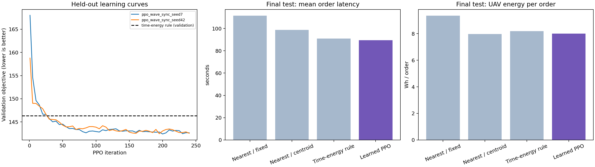

# V2 调度模型实验结果

最终模型：`experiments/dispatch_v2/runs/ppo_wave_sync_seed7/best.pt`，已封装为 `results/dispatch_policy.pt`。
只依据 64 个验证场景选模，再评估从 4000000 开始的 512 个新场景。
停止判据全部满足：**True**。这是经验平台及规则基线改进，不代表全局最优。

## 最终测试

| 方法 | 平均订单时延 s | 总无人机能耗 Wh/任务 | 能耗 Wh/单 | 综合目标 |
|---|---:|---:|---:|---:|
| 最近订单，固定母车 | 111.612 | 124.920 | 9.364 | 167.798 |
| 最近订单，母车跟随订单中心 | 98.783 | 106.140 | 7.972 | 146.618 |
| 时间/能耗规则，母车跟随订单中心 | 91.057 | 109.140 | 8.193 | 140.215 |
| 学习选单 + 学习母车 | 89.494 | 106.511 | 8.006 | 137.527 |
| 学习选单 + 规则母车（消融） | 91.208 | 109.337 | 8.205 | 140.435 |
| 规则选单 + 学习母车（消融） | 89.455 | 106.507 | 8.007 | 137.496 |

综合目标为平均时延 + 6 × 每单能耗；表中对每个任务先计算，再对场景等权平均。
所有方法均完成全部订单；完成率由环境的合法动作和有限任务机制保障，并非学习收益。

相对较强的时间/能耗规则：

- 平均订单时延降低 1.72%；模型减基线的差值 95% 配对 bootstrap 区间为 [-1.9630, -1.1899]。
- 总无人机能耗降低 2.41%；模型减基线的差值 95% 配对 bootstrap 区间为 [-3.0551, -2.2085]。
- 每单能耗降低 2.29%；模型减基线的差值 95% 配对 bootstrap 区间为 [-0.2179, -0.1575]。
- 综合目标降低 1.92%；模型减基线的差值 95% 配对 bootstrap 区间为 [-3.2345, -2.1776]。

相对最近订单/中心母车规则，每单能耗改善为 -0.41%（负数代表增加），不能把相对强基线的结果说成优于所有规则。

本次消融显示收益主要来自学习母车接应；把选单替换为强规则后综合目标没有变差，因此当前尚未证明学习选单具有额外收益。

## 收敛证据

| 训练运行 | 验证集最佳综合目标 | 最后60次更新的最佳值改善 | 进入平台 |
|---|---:|---:|---|
| ppo_wave_sync_seed7 | 142.391 | 0.177% | True |
| ppo_wave_sync_seed42 | 142.448 | 0.055% | True |

两轮最终训练均为从随机参数开始的 PPO，没有使用行为克隆；每轮 240 次更新、23040 个训练任务。
训练种子分别为 7、42；策略只有 24610 个参数，在 CPU 上运行。

## 已验证的边界

这是全量订单提前已知、三架无人机按波次共同出发/回收的解析调度环境。
尚不包含动态到单、避障或真实飞行动力学，能耗参数未经实机标定。
模型能自主输出无人机订单选择和母车接应点；不输出旧版连续飞行方向，现已通过 ONNX 接入 V2 前端；本报告数字仍仅对应离线静态环境。
母车/选单消融是动作替换而非独立重训，应结合状态分布变化解读。
五项环境测试覆盖奖励与目标一致性、电池余量、互斥订单、单舱排队、预起飞充电时序及模型排列等变性。

详见 [实验方法与复现](README.md)、[原始最终指标](results/summary.json)、[逐场景数据](results/cases_ppo.json)。
