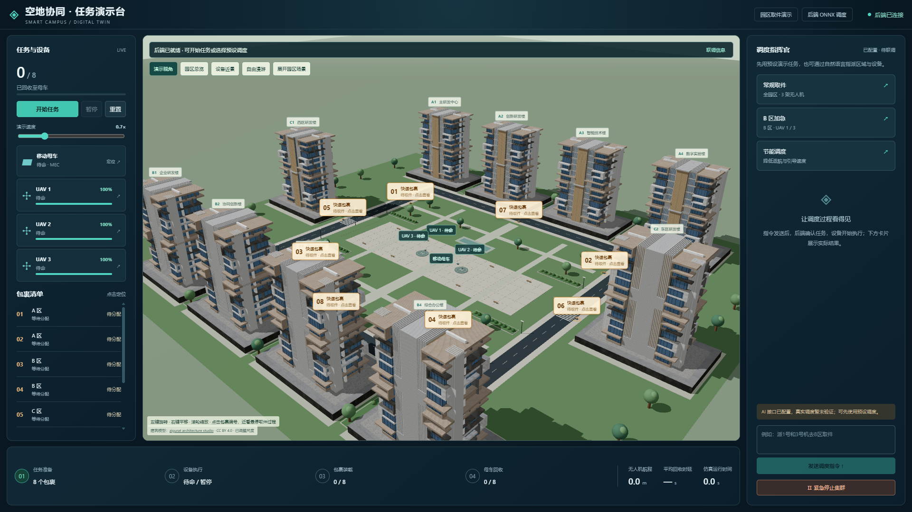

# 空地协同 · 前端数字孪生任务演示台

当前 Three.js / React Three Fiber 园区前端，支持白天园区地图、母车与三架无人机、快递包裹、平滑遥测动画、自由镜头、设备/任务定位与 MQTT 调度交互。



## 前端运行

需要 Node.js 20+，在此文件夹执行：

```powershell
cd frontend
npm ci
npm run dev
```

打开 <http://127.0.0.1:3000/r3f.html>，根路径 `/` 也是同一任务演示台。单栋合规建筑预览为 `/campus-preview.html`。

默认连接 `ws://127.0.0.1:8083/mqtt`。可在本机 `.env` 设置 `VITE_MQTT_URL` 后重新启动 Vite。后端未启动时，园区仍可查看，设备任务显示未连接，控制禁用；不会用模拟回复或随机遥测冒充真实后端。

## 完整本机演示（Windows）

`backend/` 和 `scripts/` 是本版本配套的可选本机联调工具，用于真实 ONNX 推理、任务模拟器和 MQTT Broker。原仓库根目录的算法/训练文件保持原样；这些工具补充其随机模拟器尚未提供的真实任务遥测、精确取件和执行回执。

需要 Python 3.12：

```powershell
py -3.12 -m venv .venv
.\.venv\Scripts\python.exe -m pip install -r backend/requirements.txt
npm run demo
```

如果已运行前端，启动脚本会复用3000端口。Broker 使用本机1883和8083端口。点击“开始任务”运行8个包裹完整取件回收；“B区加急”只派UAV1和UAV3取B区包裹；节能预设和急停也是实际后端命令。`npm run demo:stop` 停止脚本创建的服务。

前端只接收遥测、转换坐标和渲染，ONNX推理、任务分配、运动、到达判定、装载回收与统计都在Python后端。模型内部保留原仓库的6/10维观测和归一化坐标，遥测发布米制坐标。固定本机MEC推理，当前不含动态云边卸载。详见 [接入与运行文档](docs/backend-integration.md)。

## AI配置

仓库仅提供 `.env.example`，真实 API Key 没有上传。使用AI时复制为本机 `.env`，填写后端 `CAMPUS_AI_BASE_URL`、`CAMPUS_AI_API_KEY` 与可选 `CAMPUS_AI_MODEL`。

本地 OpenAI 兼容网关默认地址 `http://127.0.0.1:8045/v1`，模型优先选择实际列表中的 `gemini-2.5-flash`。后端调用 `/models`、`/chat/completions`，通过 `simulation/command/input` 接收聊天，并对结构化调度产生执行回执。密钥只留在后端，不进入网页。当前真实AI联调尚未成功，用户已决定后续自行修复网关上游连接；预设调度独立可用。页面明确区分“已配置·待联调”与AI成功。

## 构建和测试

```powershell
npm run build
npm run test:frontend
npm run test:backend
```

启动配套服务后，可运行 `npm run test:integration` 实际验证MQTT控制和8单回收。集成测试会重置任务，不要在正式演示中同时运行。前端构建不需要Python。

## 目录

- `src/rendering/`：园区、GLB建筑、设备、旋翼/包裹动画及镜头。
- `src/services/`：MQTT连接、快照校验和插值。
- `src/ui/`：任务/设备、调度和进度面板。
- `public/`：实际使用的建筑GLB、图标和四个原仓库ONNX模型。
- `backend/`、`scripts/`：可选本机演示辅助服务。
- `tests/`：协议、取件、后端、AI适配及MQTT回归测试。
- `src/core/`：此前浏览器仿真实现，仅保留供回归对照，默认页面不加载。
- `docs/`：许可、架构、验收与实景截图。

## 资产署名

建筑：**“modern tower office apartment house home” by zigurat architecture studio**，采用 [CC BY 4.0](https://creativecommons.org/licenses/by/4.0/)，[原始模型](https://sketchfab.com/3d-models/modern-tower-office-apartment-house-home-a057bf3379b24c23a18a82ec884e4f04)。本项目调整尺寸与场景摆放，页面保留署名。授权详情见 [资产许可记录](docs/asset-licenses.md)。包裹为项目原创组件。
